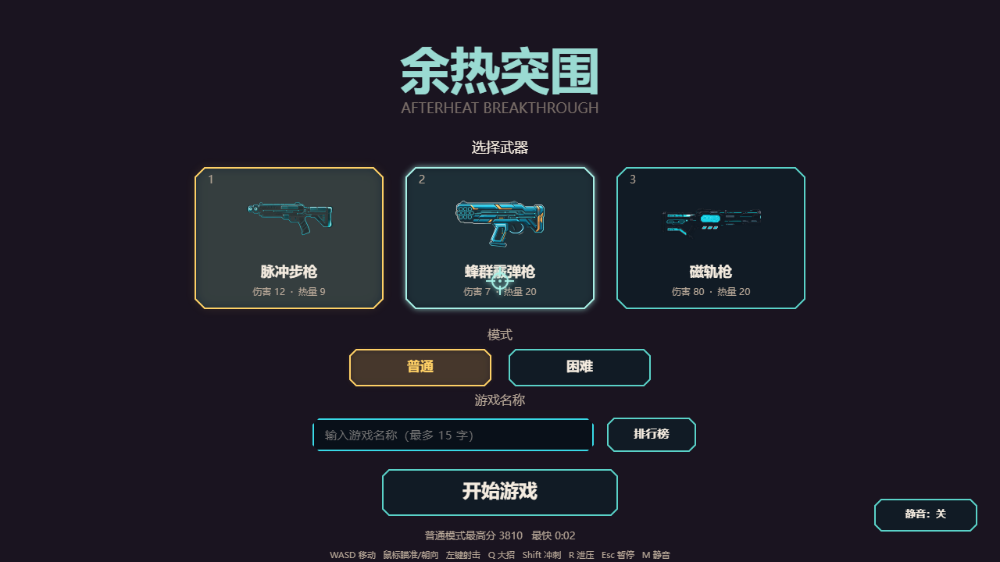
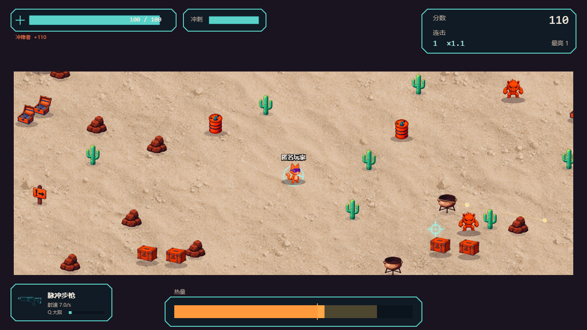
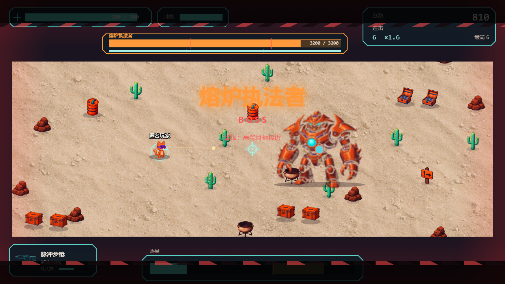
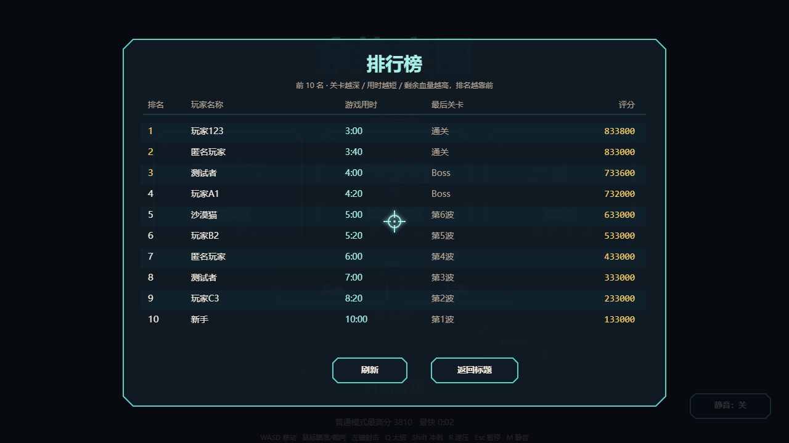
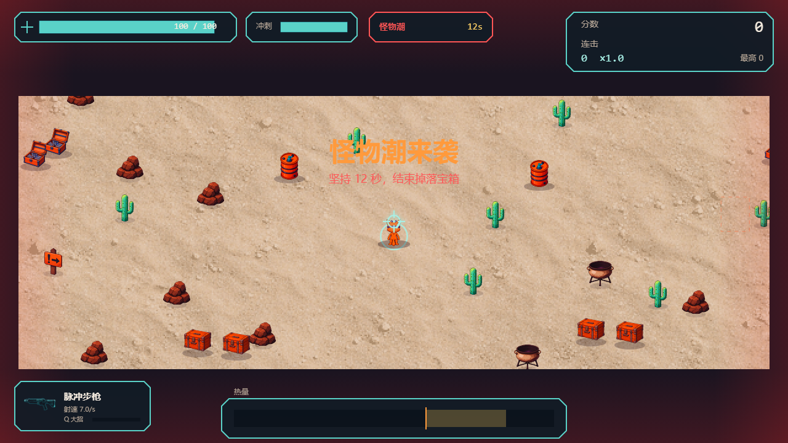

# 余热突围 / Afterheat Breakthrough

俯视像素风 Roguelite 射击游戏。控制一只戴紫色护目镜的小兽，在沙漠、紫晶遗迹与绿洲前哨中迎战 6 波敌人和三阶段 Boss「熔炉执法者」。

无需构建工具，浏览器直接打开 `index.html` 即可游玩；排行榜通过 Netlify Functions + Blobs 提供。

## 预览







## 操作

| 输入 | 行为 |
|---|---|
| WASD | 八方向移动 |
| 标题页输入框 | 输入游戏名称（最多 15 字，中文/英文/数字） |
| 鼠标移动 | 人物朝向 / 瞄准 |
| 鼠标左键 | 射击 |
| Q | 武器大招（能量满 100 时） |
| Shift | 相位冲刺 |
| R | 主动泄压（完美泄压触发子弹时间与范围伤害） |
| F | Boss 血量 ≤12% 时靠近处决 |
| Esc | 暂停 / 继续 |
| M | 静音 |

## 主要特性

- 3 把武器：脉冲步枪、蜂群霰弹枪、磁轨枪，各自拥有武器大招与进化条件
- 5 类敌人：冲锋者、瞄准枪手、浮空无人机、盾兵、投掷兵；另有精英怪
- 6 波战斗 + 6 次三选一升级，12 项升级、4 条构筑路线
- 热量 / 普通泄压 / 完美泄压 / 过热系统
- 大世界 + 镜头边缘跟随，地图尺寸 2440×888
- 掉落物：+5 生命、随机换枪、全图清场核弹、精英宝箱
- 事件点：献祭祭坛（-15 HP 换升级）、补给商人（-400 分换升级）
- 怪物潮：限时高密度刷怪，结束掉落宝箱
- Boss「熔炉执法者」：3200 HP + 800 装甲、装甲破坏硬直、处决窗口、震撼登场
- 暴击顿帧、伤害数字分级、击杀播报、低血量/怪物潮/Boss 登场屏幕边缘反馈
- 游戏名称显示在人物头顶；种子 ID 内部随机生成并隐藏
- 排行榜：记录名称、开始/结束时间、最后关卡、种子、评分；评分按关卡 > 用时 > 剩余血量计算
- 排行榜仅展示前 10 名，数据存 Netlify Blobs
- 困难模式、种子复现、暂停、静音

## 运行

直接双击 `index.html`，使用 Chrome / Edge 打开即可（此时排行榜不可用，需通过 Netlify 访问）。

本地调试也可以启动 HTTP 服务：

```bash
python -m http.server 8000
```

然后访问 `http://localhost:8000/`。

## 项目结构

```text
index.html          canvas 与脚本入口
js/
  config.js         常量、数值、升级定义
  utils.js          数学、随机数、存储、粒子
  state.js          Game 状态与相机
  assets.js         素材清单、加载、音效
  input.js          键鼠输入
  maps.js           三套地图与大世界布局
  player.js         玩家移动/朝向/泄压/武器/大招
  enemies.js        敌人创建与 AI
  bullets.js        子弹、伤害、击杀、计分
  loot.js           掉落物、事件点、怪物潮
  boss.js           Boss 登场/阶段/装甲/处决
  systems.js        波次、升级、结算、状态迁移
  render.js         世界绘制、特效、准星、头顶名称
  profile.js        名称输入（DOM input / IME / 字符过滤）
  leaderboard-client.js  排行榜 HTTP 客户端（唯一 fetch 入口）
  leaderboard-panel.js   排行榜前 10 面板
  ui.js             HUD、标题、升级、暂停、结算
  main.js           初始化、主循环、调试接口
netlify/
  functions/records.js   GET/POST /api/records
  lib/rating.js          服务端评分/校验
netlify.toml          Netlify 部署与 /api/records 重定向
package.json          @netlify/blobs 依赖
assets/
  game/             运行素材（高清精灵、地面、音效）
  ui/               武器/升级图标
  kenney_.../       Kenney 原始素材包
preview/            交付截图
tools/              测试与素材处理脚本
```

## Netlify 部署

1. 在 Netlify 连接 GitHub 仓库 `KoLei-Fei/HotBreakthrough`
2. Build command 留空
3. Publish directory 填 `.`
4. Functions directory 使用 `netlify/functions`
5. 部署后访问 Netlify 给出的站点域名

排行榜接口：`GET/POST /api/records`，记录保存在 Netlify Blobs，不使用本地电脑存储。

> Netlify 在中国大陆的访问质量不稳定，正式对外前需用目标网络实测。

## 测试

```bash
node tools/SmokeTopDown.js
node tools/CapturePreview.js
```

## 素材与致谢

- 地形与音效来自 [Kenney Desert Shooter Pack](https://kenney.nl/assets/desert-shooter-pack)（CC0）
- 高清角色、敌人、掩体与地面纹理由 Seedream 生成并经本地脚本处理
- 游戏代码与当前版本由 yifei.zhang 整理

## License

代码与当前仓库内容采用 MIT License，详见 [LICENSE](LICENSE)。
第三方素材仍遵循其原始授权（Kenney 素材为 CC0）。
